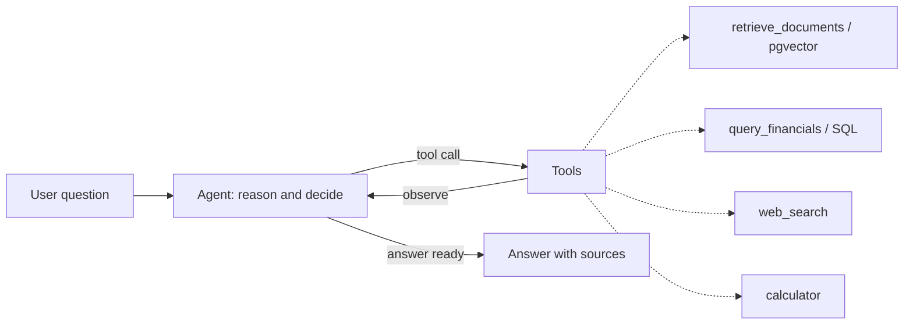

# SEC Filings Research Agent

An agentic RAG system that answers questions about SEC 10-K filings for Apple and Microsoft. Instead of a fixed retrieve-then-generate pipeline, the agent decides for itself which tools to call, judges whether it has enough context, reformulates its query when retrieval falls short, and only then answers.

**Live demo:** https://rag-agent-874480290615.europe-west1.run.app/

**Stack:** FastAPI (streaming) · LangGraph · OpenAI (GPT-5.6, text-embedding-3) · PostgreSQL + pgvector · RAGAS · LangSmith · Docker · Google Cloud Run + Cloud SQL

## Why this is an agent, not a pipeline

A classic RAG pipeline always runs the same three steps: embed the question, fetch the top matches, generate an answer. It cannot recover from a bad retrieval, and it has no way to reach data that lives outside the vector store.

This project uses a real agent loop built on LangGraph. At each step the model chooses an action: search the filing text, look up exact financial figures, run a calculation, or check the live web. After a tool returns, the model decides whether the result actually answers the question, and if not it reformulates and tries again before responding.



## Tools the agent can choose

- **retrieve_documents**: semantic search over 10-K narrative sections (business, risk factors, MD&A), stored as embeddings in pgvector.
- **query_financials**: exact figures from the income statements, stored in relational tables. Parameterized and read only, so a model-supplied keyword can never inject SQL.
- **calculator**: a safe arithmetic evaluator built on Python's AST (no `eval`), because language models are unreliable at mental math.
- **web_search**: live web results via Tavily, for anything outside the filings.

## Evaluation

Quality is measured with RAGAS on a small labeled set, comparing the agent against a linear RAG baseline. Metrics are split into retriever quality (context precision and recall) and generator quality (faithfulness and answer relevancy).

| Metric | Baseline | Agent |
|---|---|---|
| Answer relevancy | 0.28 | 0.89 |
| Context precision | 0.47 | 1.00 |
| Context recall | 0.33 | 1.00 |
| Faithfulness | 0.93 | 0.68 |

The agent wins decisively on the three metrics that drive usefulness. The baseline scores poorly on numeric questions because it has no way to reach the numbers.

The faithfulness result is the interesting one. The baseline scores high not because it is accurate but because it often answers "I don't have enough information", and an answer with almost no claims has almost nothing to contradict. The agent scores lower because its derived figures (for example a percentage change computed by the calculator) do not appear verbatim in the raw tool output, so the judge flags them. The takeaway is that these metrics have to be read together rather than one at a time.

## How it works

**Ingestion (offline).** Filings are downloaded with edgartools. Narrative sections are chunked (token aware, with overlap), embedded with `text-embedding-3-small`, and stored in pgvector. Income statement figures are loaded into relational tables.

**Serving (online).** FastAPI exposes a `/chat` endpoint that streams the agent's progress over Server-Sent Events, emitting both step events (which tool is running) and answer tokens as they are generated. Conversation state is kept in a LangGraph checkpointer keyed by thread id.

**Observability.** Every run is traced in LangSmith, which shows the full reason, act, observe loop with token counts and latency per step.

## Running locally

Prerequisites: Docker, Python 3.12, an OpenAI API key, a Tavily API key.

```bash
# 1. Start Postgres with pgvector
docker compose up -d

# 2. Configure
cp .env.example .env      # then fill in the API keys and a database password

# 3. Install
python -m venv .venv && source .venv/bin/activate
pip install -r requirements-dev.txt

# 4. Load the corpus (Apple and Microsoft 10-K filings)
python -m ingestion.run
python -m ingestion.run_financials

# 5. Run the API
uvicorn app.main:app --reload
# open http://localhost:8000
```

Ask from the command line:

```bash
python -m agent.run "How did Apple's net sales change from FY2023 to FY2024, in percent?"
```

Run the evaluation:

```bash
python -m evaluation.run_eval
```

## Deployment

The service runs on Google Cloud Run, built from the Dockerfile by Cloud Build. PostgreSQL with pgvector is managed by Cloud SQL and reached over a Cloud SQL unix socket. All keys live in Secret Manager and are injected as environment variables. The serving image installs only runtime dependencies (`requirements.txt`); ingestion and evaluation dependencies are kept in a separate `requirements-dev.txt` so the deployed image stays small.

## Project structure

```
app/          FastAPI app, config, SSE streaming, static UI
agent/        LangGraph agent: graph, tools, runner
tools/        the four agent tools (retrieve, financials, web, calculator)
rag/          the linear RAG baseline (retriever, prompt, generate)
ingestion/    corpus download, chunking, embedding, storage
evaluation/   RAGAS eval suite and labeled dataset
```

## Notable engineering decisions

- Text and numbers are stored separately (pgvector for narrative, relational tables for figures), so each question type uses the retrieval method that fits it.
- The SQL tool is parameterized and read only rather than free-form text to SQL, to avoid injection.
- The calculator uses an AST evaluator instead of `eval`, to avoid arbitrary code execution.
- Runtime and development dependencies are split so the deployed image carries only what it needs to serve requests.